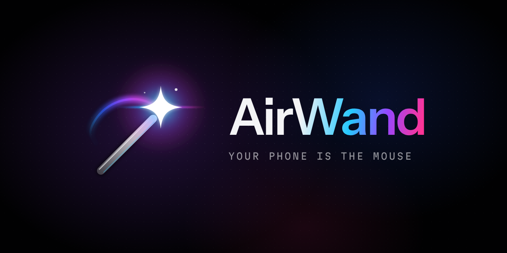
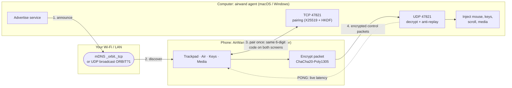

<div align="center">



# AirWand

**Wave your phone, move your cursor. The trackpad, air pointer and remote for every computer you own.**

[](https://github.com/0xCodez/orbit/actions/workflows/desktop.yml)
[](https://github.com/0xCodez/orbit/actions/workflows/mobile.yml)
[](LICENSE)


Trackpad · Air pointer · Keys · Media — for your Mac and your PC, one swipe apart.

Interactive design prototype: [`docs/prototype/b-prism.html`](docs/prototype/b-prism.html) (download and open in a browser; on a phone it runs full-screen).

[Features](#features) · [How it works](#how-it-works) · [Install](#install) · [Gestures](#gesture-cheat-sheet) · [Build](#building-from-source) · [FAQ](#faq)

</div>

---

## Features

- **Trackpad with gestures.** Full-screen multitouch surface: move, tap to click, two-finger right click, two-finger scroll with inertia, tap-and-hold to drag, pinch to zoom, three-finger swipe up for Mission Control / Task View. A soft anamorphic light follows your finger.
- **Air pointer.** Hold the lens button and point the phone at the screen like a laser pointer. Gyro-driven, smoothed with a 1€ filter on the computer, recalibrate with one tap on *Center*.
- **Keys.** Type on your phone's keyboard and it streams to the computer. Special keys row (Esc, Tab, Backspace, Enter, arrows) and OS-aware shortcut chips: Copy, Paste, Undo, Spotlight / Search, Screenshot, with ⌘ on Mac and Ctrl / Win on Windows.
- **Media and Presenter.** Play / pause, previous / next, volume and mute. *Presenter* turns the whole screen into two giant Back / Next areas.
- **Multi-computer switching.** Pair your MacBook, your office PC and your living-room Mac mini. **Swipe three fingers left or right** on the trackpad to jump between them, or tap the host pill at the top.
- **AirDrop-like discovery.** Computers running AirWand appear on a radar as soon as they are on the same Wi-Fi (mDNS / Bonjour, with a UDP broadcast fallback and manual IP entry).
- **Numeric-comparison pairing.** Like Bluetooth: both screens show the same 6-digit code and you confirm it on the computer. A man-in-the-middle on the LAN cannot fake it.
- **End-to-end encrypted UDP.** Every control packet is authenticated and encrypted with ChaCha20-Poly1305 using a key derived from an X25519 exchange. Unpaired devices cannot move your cursor.
- **No cloud, no accounts.** Nothing leaves your local network. No sign-up, no telemetry, no server.

## How it works

AirWand has two halves: the **phone app** (Flutter, `mobile/`) and a tiny **desktop agent** (Rust, `desktop/`) that lives in the menu bar / system tray and injects input into the OS. They talk directly over your LAN.



1. **Discovery.** The agent advertises `_orbit._tcp` over mDNS. The phone shows it on the radar.
2. **Pairing.** One TCP connection: both sides exchange ephemeral X25519 keys, derive a shared key and a 6-digit code with HKDF-SHA256. You confirm the code on the computer.
3. **Control.** Every touch becomes a small encrypted UDP packet (move, click, scroll, gesture, key, text, media, aim). The agent decrypts it, checks the sequence number and injects the input.

The full wire format is in [`docs/PROTOCOL.md`](docs/PROTOCOL.md); the component design is in [`docs/ARCHITECTURE.md`](docs/ARCHITECTURE.md).

## Install

Grab the latest builds from the [Releases page](https://github.com/0xCodez/orbit/releases). You need the agent on every computer and the app on your phone. Phone and computer must be on the same network.

### macOS

1. Download `AirWand-macos-universal.zip` (Apple silicon and Intel), unzip it and move **AirWand.app** to `/Applications`.
2. The app is ad-hoc signed, not notarized yet. On first launch **right-click AirWand.app → Open → Open**. On recent macOS versions you may instead need *System Settings → Privacy & Security → Open Anyway*.
3. Grant **Accessibility** permission when asked (*System Settings → Privacy & Security → Accessibility → AirWand*). Without it macOS silently ignores injected mouse and keyboard events. If you update AirWand and input stops working, remove AirWand from the list and add it again.
4. Allow incoming network connections if the firewall asks. AirWand uses TCP and UDP port **47821**.

### Windows

1. Download `airwand-windows-x64.exe` and put it somewhere permanent, for example `%LOCALAPPDATA%\AirWand\airwand.exe`.
2. Run it. SmartScreen may warn about an unknown publisher: *More info → Run anyway*.
3. When Windows Defender Firewall asks, allow access on **Private networks**. If you missed the prompt or your network is marked Public, open PowerShell **as Administrator** and run the bundled script:
   ```powershell
   powershell -ExecutionPolicy Bypass -File .\firewall-windows.ps1
   ```
   It opens TCP and UDP port 47821 for AirWand. (In the source tree it lives at `desktop/scripts/firewall-windows.ps1`.)
4. AirWand appears in the system tray. Note that Windows does not let any app inject input into elevated (Run as administrator) windows unless the agent itself runs elevated.

### iPhone

AirWand is not on the App Store yet. Two options:

- **Sideload the IPA.** Download `airwand-ios-unsigned.ipa` and sign it with your own Apple ID using a tool such as AltStore or Sideloadly. A free Apple ID signature expires after 7 days.
- **Build it yourself** with Xcode (see [Building from source](#building-from-source)) and run it on your device.

On first launch, allow **Local Network** access: iOS requires it for discovery and for talking to your computer. If you denied it, enable it in *Settings → Privacy & Security → Local Network → AirWand*.

### Android

1. Download `airwand-android.apk` on the phone.
2. Allow your browser or file manager to *install unknown apps* when Android asks, then install.
3. Or from a computer: `adb install airwand-android.apk`.

### Solana Seeker / Saga

Seeker and Saga run Android, so they use the same APK:

1. Download `airwand-android.apk` and install it as above, or with `adb install airwand-android.apk`.
2. Everything works the same way as on any Android phone.

Distribution through the **Solana dApp Store** is planned for a later release (see [`docs/ROADMAP.md`](docs/ROADMAP.md)).

### First connection

1. Start the agent on your computer.
2. Open AirWand on the phone. Your computer appears on the radar within a second or two. If it does not (some routers block multicast), use **Enter IP manually**.
3. Tap it. Both screens show the same 6-digit code. Click **Allow** on the computer.
4. Done. To add another computer, tap the host pill → **Add computer**.

## Gesture cheat sheet

### Trackpad

| Gesture | Action |
|---|---|
| One finger move | Move the pointer |
| Tap | Left click |
| Double tap | Double click |
| Two-finger tap | Right click |
| Two-finger drag | Scroll (with inertia) |
| Tap and hold, then move | Drag (a lock badge appears) |
| Pinch | Zoom in / out |
| Three-finger swipe up | Mission Control (Mac) / Task View (Windows) |
| Three-finger swipe left / right | Switch to the previous / next paired computer |
| Scroll strip on the right edge | One-finger vertical scroll |

### Other modes

| Mode | How |
|---|---|
| **Air** | Hold the lens button and point; release to stop. *Center* recalibrates. Left / Right buttons click. |
| **Keys** | Type in the text field; it streams live. Special-key row and shortcut chips adapt to Mac or Windows. |
| **Media** | Play / pause, previous / next, volume slider, mute. |
| **Presenter** | Toggle in Media: left half = Back, right half = Next. |

Pointer speed, acceleration, scroll speed, natural scrolling, tap-to-click and haptics are in **Settings**.

## Project structure

```text
orbit/
├── desktop/                     Rust desktop agent (crate "airwand-desktop", binary "airwand")
│   ├── Cargo.toml
│   ├── src/                     discovery, pairing, encrypted UDP control, input injection, tray
│   └── scripts/
│       ├── bundle-macos.sh      universal build -> desktop/dist/AirWand.app (ad-hoc signed)
│       └── firewall-windows.ps1 opens TCP+UDP 47821 in Windows Defender Firewall
├── mobile/                      Flutter app "airwand" (iOS, Android, Solana Seeker/Saga)
│   ├── pubspec.yaml
│   ├── lib/                     screens, gestures, discovery, pairing, crypto, UDP client
│   ├── test/
│   └── tool/bootstrap.sh        generates android/ and ios/ (not committed)
├── docs/
│   ├── PROTOCOL.md              wire protocol v1: the contract between phone and computer
│   ├── DESIGN.md                design language, tokens, motion, haptics
│   ├── ARCHITECTURE.md          components, threading, sequence diagrams
│   ├── ROADMAP.md
│   └── prototype/index.html     interactive UI prototype
├── .github/                     CI workflows, issue forms, Dependabot
├── CONTRIBUTING.md
├── SECURITY.md
└── LICENSE
```

## Building from source

### Desktop agent

Requirements: Rust stable via [rustup](https://rustup.rs). macOS needs the Xcode Command Line Tools; Windows needs the MSVC build tools (Visual Studio Build Tools, "Desktop development with C++").

```bash
cd desktop
cargo run --release             # run the agent from source
cargo test

# macOS: universal, ad-hoc signed app bundle -> desktop/dist/AirWand.app
rustup target add aarch64-apple-darwin x86_64-apple-darwin
bash scripts/bundle-macos.sh
```

On Windows the binary is `desktop\target\release\airwand.exe`.

### Phone app

Requirements: Flutter stable, plus Android Studio / Android SDK (Java 17) for Android and Xcode for iOS. The `android/` and `ios/` folders are generated, not committed.

```bash
cd mobile
bash tool/bootstrap.sh          # generates the platform folders (use Git Bash on Windows)
flutter pub get
flutter run                     # on a connected phone

flutter build apk --release                 # Android / Seeker / Saga
flutter build ios --release --no-codesign   # iOS (sign in Xcode to run on a device)
```

CI builds everything on every push; tagged releases (`v*`) attach the macOS zip, Windows exe, Android APK and unsigned iOS IPA to the GitHub Release. See [CONTRIBUTING.md](CONTRIBUTING.md).

## FAQ

**Why Wi-Fi and not Bluetooth?**
Wi-Fi lets one phone control many computers and switch between them instantly, with no re-pairing at the OS level, and it works the same on iPhone and Android. iOS does not allow apps to act as a Bluetooth keyboard or mouse at all. On Android it is possible, and a Bluetooth HID mode that needs no desktop agent is on the [roadmap](docs/ROADMAP.md) for v0.2.

**Why do I need to install something on the computer?**
A phone cannot move a computer's cursor by itself. Over Wi-Fi something on the computer has to receive the input and hand it to the OS; that is the agent. It is a small native binary, no runtime, no background services, and it only accepts input from phones you have paired.

**How fast is it?**
Each touch is sent immediately as one small UDP packet, with no batching, no TCP head-of-line blocking and no server in the middle. On a good 5 GHz home network the round trip is usually a few milliseconds; the host pill shows live latency (mint under 15 ms, amber under 40 ms). Crowded 2.4 GHz networks and Wi-Fi power saving add jitter; keeping the computer on Ethernet or 5 GHz helps.

**Is it secure?**
Pairing uses X25519 key exchange plus numeric comparison of a 6-digit code, so an attacker on your network cannot sit in the middle. After pairing, every packet is encrypted and authenticated with ChaCha20-Poly1305; packets from unpaired devices are dropped silently. There is no cloud and no account. One known v0.1 limitation (replay of an old recorded session) is described in [SECURITY.md](SECURITY.md) and fixed on the roadmap.

**My computer does not show up on the radar.**
Check that both devices are on the same network and not on a guest network with client isolation. Some routers block multicast: AirWand then falls back to a UDP broadcast, and you can always type the computer's IP. On Windows make sure port 47821 is allowed (see the firewall script). On iPhone make sure Local Network access is on.

**Does it work with several phones?**
Yes. Each phone pairs separately, and the computer keeps one key per phone.

## Credits

Inspired by [AimMac](https://github.com/Coolerwave/AimMac) by Coolerwave.

## License

[MIT](LICENSE) © 2026 AirWand contributors.

---

## Коротко по-русски

**AirWand** превращает телефон (iPhone, Android, Solana Seeker / Saga) в трекпад, аэро-указку, клавиатуру и пульт для Mac и Windows.

- **Трекпад с жестами:** клик тапом, правый клик двумя пальцами, прокрутка, перетаскивание, зум щипком, свайп тремя пальцами вверх для Mission Control / Task View.
- **Несколько компьютеров:** свайп тремя пальцами влево / вправо переключает между сопряжёнными компьютерами.
- **Поиск как в AirDrop:** компьютеры в той же Wi-Fi сети появляются на радаре сами (mDNS), можно ввести IP вручную.
- **Безопасно:** сопряжение по 6-значному коду на обоих экранах, весь трафик зашифрован (X25519 + ChaCha20-Poly1305). Никакого облака и аккаунтов.

**Как начать:** скачайте агент для компьютера и приложение для телефона со [страницы релизов](https://github.com/0xCodez/orbit/releases). На macOS дайте AirWand разрешение «Универсальный доступ» (Accessibility), на Windows разрешите порт 47821 в брандмауэре. На Seeker / Saga ставится тот же APK, что и на Android; позже появится в Solana dApp Store.

Сборка из исходников, протокол и архитектура описаны выше и в папке [`docs/`](docs/).
