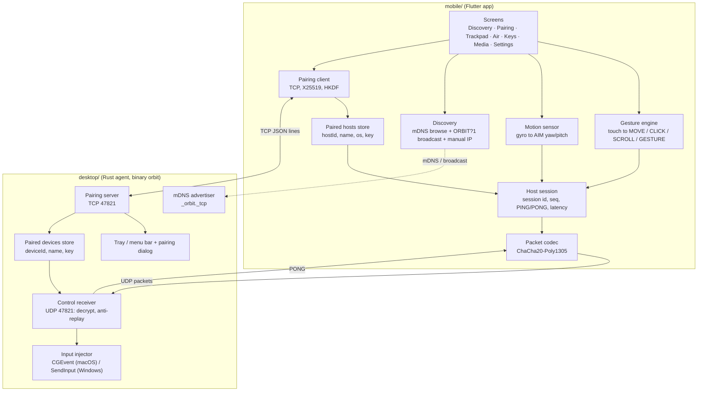
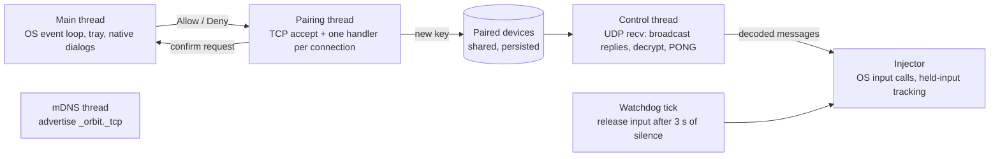
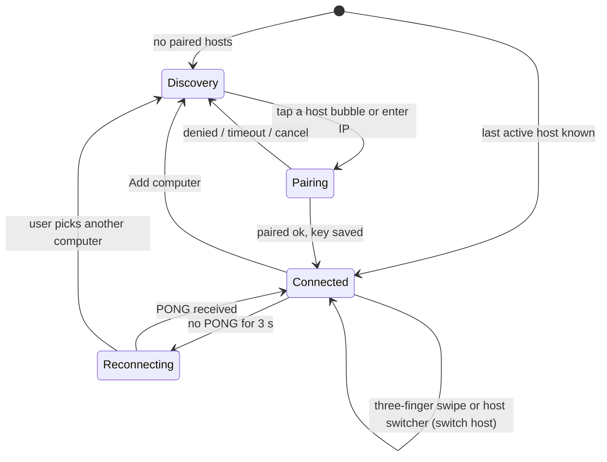
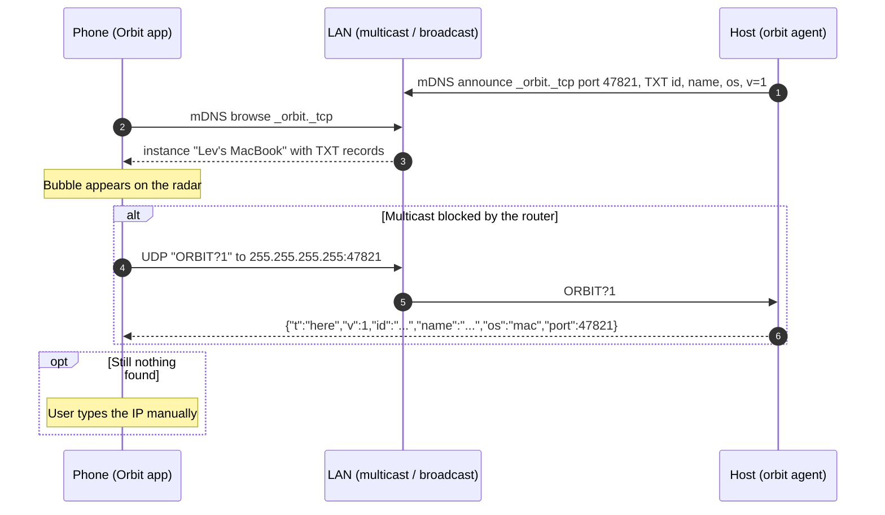
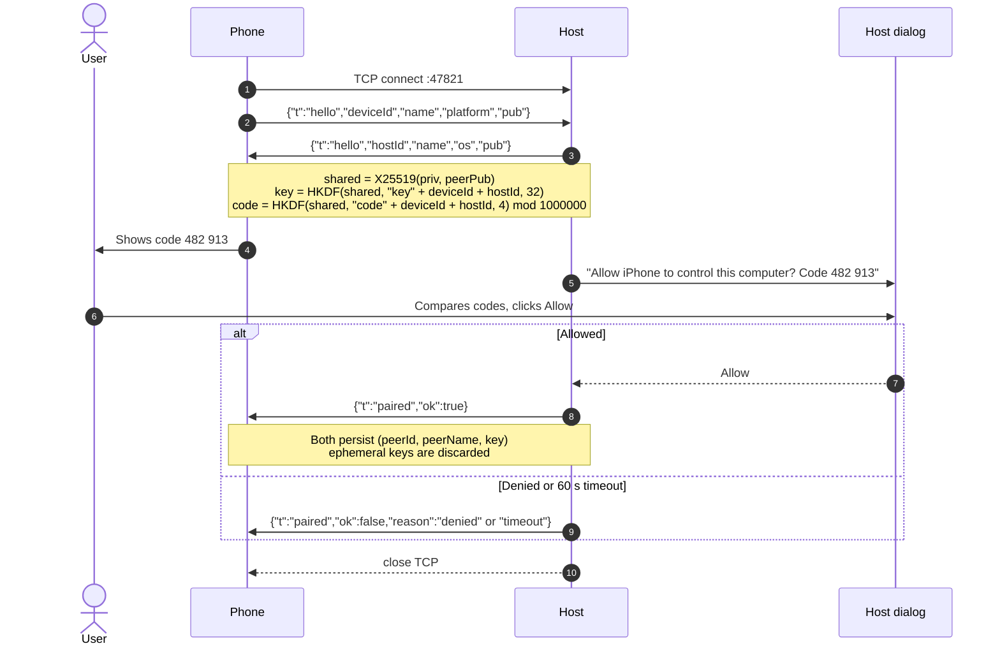
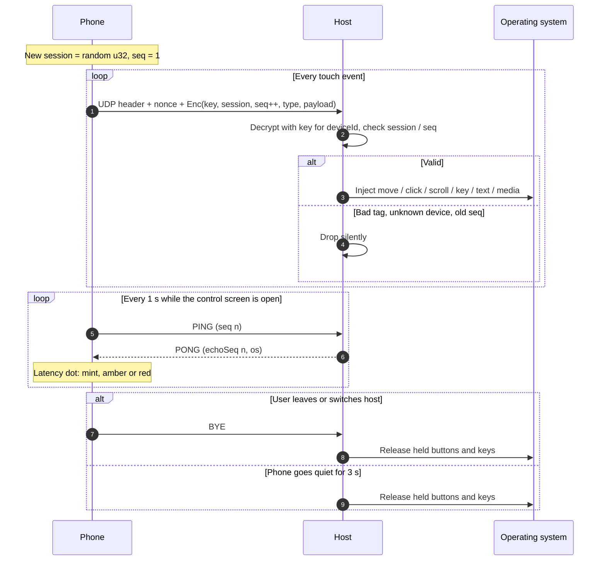

# Orbit Architecture

This document explains how the pieces fit together. The wire format itself is defined only in [PROTOCOL.md](PROTOCOL.md), and the look and feel only in [DESIGN.md](DESIGN.md); this file refers to them and does not redefine them. It describes the design both implementations follow; module and file names in `desktop/src` and `mobile/lib` may differ in detail.

## Components

| Component | Responsibility |
|---|---|
| **Gesture engine** (mobile) | Turns raw multitouch into protocol messages: pointer acceleration, tap / double-tap / two-finger tap, scroll with inertia, tap-and-hold drag (BUTTON down/up), pinch (GESTURE zoom), three-finger swipes (overview or host switch). |
| **Motion sensor** (mobile) | Integrates the gyroscope into yaw / pitch relative to the calibrated center and sends AIM while the lens button is held. Smoothing happens on the host. |
| **Discovery** (mobile) | Browses `_orbit._tcp`, sends `ORBIT?1` broadcasts as a fallback, merges results by `hostId`. |
| **Pairing client / server** | One TCP connection per pairing. Ephemeral X25519, HKDF-SHA256 key and 6-digit code, user confirmation on the host. |
| **Host session** (mobile) | Owns the UDP socket for the active host, the random `session`, the monotonically increasing `seq`, the 1 s PING timer and the latency estimate shown in the host pill. |
| **Control receiver** (desktop) | Validates header, looks up the key by `deviceId`, decrypts, enforces the session / seq rule, answers PING with PONG, tracks liveness (3 s). |
| **Input injector** (desktop) | Maps messages to OS input: relative moves, buttons, clicks with click count, pixel scrolling with fractional accumulation, OS shortcuts for GESTURE, HID usage to native key codes, text typing, media keys, AIM mapping onto the virtual desktop with a 1€ filter. |

## Desktop agent: threading

The agent is a single process with a few long-lived threads that communicate over channels. No thread blocks another for longer than one packet.

- **Main thread.** macOS requires AppKit (the status item and the *Allow / Deny* alert) to run on the main thread, and Windows tray icons need a message loop, so the main thread runs the platform event loop and nothing else. Other threads ask it to show the pairing dialog and wait for the answer, with the 60 s timeout from the protocol.
- **mDNS thread.** Registers the service with TXT records `id`, `name`, `os`, `v`, and unregisters on exit.
- **Pairing thread.** Accepts TCP connections on 47821. Each pairing is handled in its own short-lived handler so a slow or malicious client cannot block another pairing. On *Allow* it writes the new `(deviceId, name, key)` to the store; re-pairing replaces the key.
- **Control thread.** One UDP socket on 47821. Plain `ORBIT?1` probes get the JSON `here` reply; every other payload must be a valid encrypted packet or it is dropped silently. Per device it keeps `last session`, `last seq` and `last seen`.
- **Injector.** Owns all OS input state: currently held buttons and keys, scroll fraction accumulators, the 1€ filter state for AIM. Keeping this in one place makes "release everything" on BYE or timeout trivial and race-free.
- **Watchdog.** A periodic tick (well under a second) checks `last seen`; a device silent for more than 3 s is marked disconnected and its held input is released.
- **Store.** The paired-devices table is shared between the pairing and control threads behind a lock and persisted to the user's configuration directory on every change.

## Mobile app: state flow

- **App state** holds: the list of discovered hosts, the paired-hosts store, the active host, the current mode (Trackpad / Air / Keys / Media) and user settings (pointer speed, acceleration, scroll speed, natural scrolling, haptics, tap-to-click, theme).
- **Discovered vs paired.** A discovered host is just an address and a name. A paired host has a key. Hosts are matched by `hostId`, so a computer that changes its IP is still recognised as the same paired host when it is rediscovered.
- **Switching computers.** Three-finger swipe left / right (or the host switcher sheet) sends BYE to the current host, picks the previous / next paired host, starts a new random `session` with `seq = 1` and starts pinging. The host pill crossfades, and the medium haptic fires once the switch is made.
- **Sending.** Every user action becomes exactly one message. Moves and scrolls are sent as they happen (no batching) so latency stays at one network hop. The phone applies pointer acceleration and the natural-scrolling choice before sending; the host does not second-guess them.
- **Lifecycle.** When the control screen closes or the app goes to the background, the app sends BYE and stops pinging. On return it starts a new session.

## Sequence diagrams

### Discovery

### Pairing

### Control

## Cross-cutting decisions

- **UDP for control, TCP for pairing.** Pairing must be reliable and is rare. Control is frequent, small and latency-sensitive: a lost MOVE is better than a late one, so there are no retransmissions. State-changing messages that must not be lost in practice (button up) are protected by the 3 s liveness rule that releases held input.
- **Phone-side feel, host-side truth.** Acceleration, inertia and natural scrolling are computed on the phone so the feel is identical on every computer. Mapping to the screen (AIM to the virtual desktop, OS shortcuts for GESTURE, HID usage to key codes) is done on the host, which knows its own OS and display layout.
- **No server.** There is no relay, account or cloud. Discovery, pairing and control are all on the LAN.
- **Protocol first.** Both sides are written against [PROTOCOL.md](PROTOCOL.md); changes follow the rule in [CONTRIBUTING.md](../CONTRIBUTING.md#the-protocol-change-rule).
